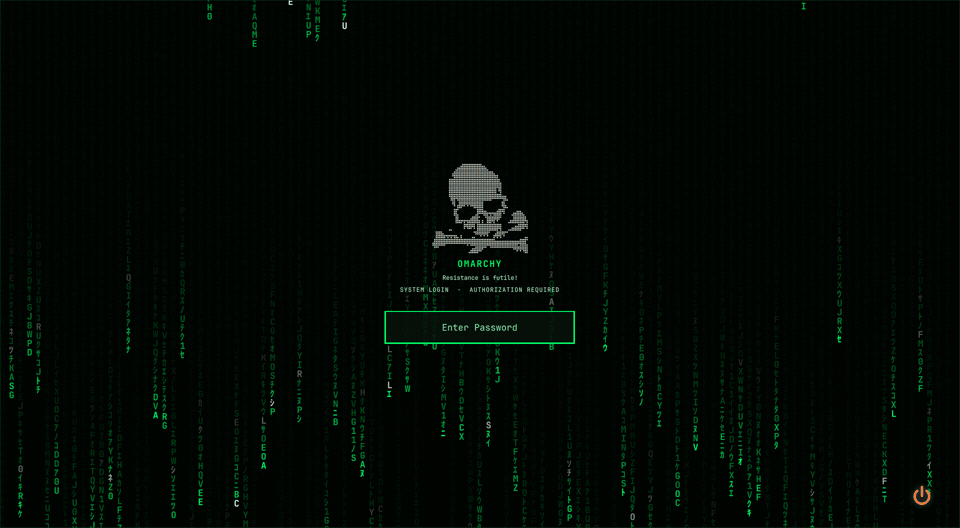
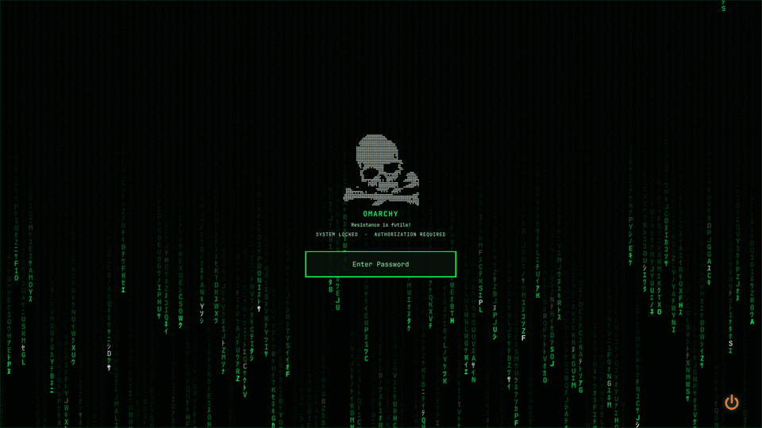

# OmaResistance

*Resistance is futile!*

**Login & Lock for Omarchy**

Animated green character rain, a dotted skull centerpiece, and matching login and lock screens for Omarchy.

**Omarchy Quattro · Qt Quick · Optional Qt 6 SDDM theme · 0.1.0 pre-release**

## Login screen



## Lock screen



## Features

- Animated Matrix-inspired character rain on a dark background.
- The original dotted skull and “Resistance is futile!” caption.
- Centered, masked password entry with authentication feedback.
- Optional fingerprint indicator when Omarchy's fingerprint authentication is configured.
- Power controls for available sleep, hibernate, restart, and shutdown actions.
- An Omarchy lock-service replacement and a separately installed SDDM login theme.

## Compatibility and dependencies

Prepared against **Omarchy 4.0.5-1**, **Quickshell 0.3.2**, **Hyprland 0.56.2**, **Qt 6.12**, and **SDDM 0.21.0**. Other versions have not been verified.

The lock plugin requires Omarchy's Quickshell shell, its `qs.Commons` and `qs.Ui` modules, Wayland session locking, PAM, and the existing `/etc/pam.d/omarchy-lock-password` configuration. It uses `bash`, `readlink`, `busctl`, `systemctl`, and Omarchy's wake, brightness, and session-status helpers, including `omarchy-hyprland-session-lock-stranded`. Recovery expects Omarchy's normal `misc.allow_session_lock_restore` setting. Fingerprint support additionally requires Omarchy's fingerprint PAM configuration, `fprintd`, and an enrolled fingerprint.

The optional login theme requires **Qt 6 SDDM**, `SddmComponents`, and **JetBrainsMono Nerd Font**. It uses SDDM's last selected user and session and does not provide user or session selectors.

## Install the lock plugin

Use an **unlocked session**. Back up `~/.config/omarchy/shell.json`, note any existing custom lock, and review the [installation and rollback guide](docs/INSTALL.md).

After this repository is published:

```sh
omarchy plugin add https://github.com/Waffles46/OmaResistance
omarchy plugin list
```

At the enable prompt, keep it disabled while reviewing the source. Disable any existing custom clone of `omarchy.lock` before enabling OmaResistance:

```sh
omarchy plugin enable waffles46.omaresistance
```

OmaResistance declares `omarchy.clonedFrom: omarchy.lock` so Omarchy can route its lock integration to the replacement. Use only one custom lock at a time: enabling one clone does not automatically disable every competing custom clone.

### Preview

```sh
omarchy shell lock preview
```

Click to dismiss it, or run `omarchy shell lock hidePreview`. A preview does not lock the session or test authentication. Test actual locking first in a disposable Omarchy session using the [validation checklist](docs/VALIDATION.md).

## Remove or restore the previous lock

From an unlocked session, restore the built-in lock and remove OmaResistance:

```sh
omarchy plugin disable waffles46.omaresistance
omarchy plugin enable omarchy.lock
omarchy plugin remove waffles46.omaresistance
```

If you previously used another custom lock, re-enable its saved ID after disabling OmaResistance. Confirm only the intended lock is enabled. Read [rollback and recovery](docs/INSTALL.md#rollback-and-recovery) before testing a replacement lock.

## Optional login theme

The login theme is a separate SDDM component. Preview it from a local checkout:

```sh
sddm-greeter-qt6 --test-mode --theme ./sddm-theme
```

Use the [SDDM setup and rollback guide](docs/SDDM.md) for system installation. Installing the Omarchy plugin does not select a system greeter. The same login QML has completed a real SDDM login on the preparation machine; a fresh installation and rollback of this renamed package remain unverified.

## Validation status

This is a pre-release package. A fresh isolated Omarchy session passed installation, secure Wayland locking, PAM rejection/unlock with synthetic credentials, Escape/Ctrl+U clearing, a 200-character password, headless-output hotplug, crash recovery, and removal. Existing-system records also confirm a real SDDM login using identical login QML.

Fingerprint hardware, physical monitor hotplug, suspend/resume, and a fresh SDDM installation/rollback remain unverified. See [validation notes](docs/VALIDATION.md) and the [test results](docs/TEST-RESULTS.json) for the exact scope.

## License and credits

Code and original contributions use the [MIT license](LICENSE), with the original [Omarchy notice](OMARCHY-LICENSE) retained. The lock service is adapted from Omarchy's `omarchy.lock`.

The skull was supplied from the author's existing design. Redistribution permission is awaiting owner confirmation before publication; see [credits and asset provenance](CREDITS.md).

By **Waffles46 and Omarchy contributors**. This is a community project, unaffiliated with the owners of the Matrix or Star Trek franchises.
